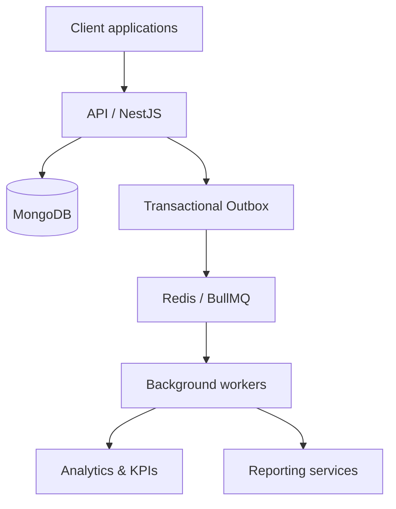

<div align="center">

# Luis Bauza

### Full Stack Developer · Backend Engineering & Software Architecture

**Beyond the interface. Into the architecture.**

*Building reliable systems, connecting ideas, and making complexity manageable.*


[](https://lebauzagit.vercel.app/) [](https://www.linkedin.com/in/lebauzagit/)

</div>

---

## A little about me

I am a full stack developer with a frontend background and a focus on backend engineering, event-driven systems, and software architecture. I enjoy understanding what happens behind the interface: how data flows, how services communicate, and how systems behave when things do not go as planned.

My work revolves around SaaS applications, API development, asynchronous processing, and developer automation. I approach software as a continuous process of learning, questioning assumptions, and improving what already exists.

> Good software is not just about what it does today, but how well it can adapt to what comes tomorrow.

## My engineering mindset

```typescript
const engineeringMindset = {
  principles: [
    'Maintainability',
    'Modularity',
    'Reliability',
    'Security by design',
  ],
  approach: 'Understand first. Build second. Improve continuously.',
  preference: 'Simple solutions to complex problems',
  learning: 'Always in progress',
} as const;
```

## Technology ecosystem

| Domain | Technologies |
| :--- | :--- |
| **Languages** | JavaScript · TypeScript · C# · PHP |
| **Backend** | TypeScript · Node.js · NestJS · REST APIs · Swagger / OpenAPI |
| **Data & persistence** | MongoDB · Mongoose · PostgreSQL · Prisma · TypeORM |
| **Asynchronous processing** | Redis · BullMQ · Background workers |
| **Security** | Passport.js · JWT · Authentication & authorization |
| **Frontend** | Vue.js (Vue 3) · Nuxt · Nuxt UI · Astro · Tailwind CSS · Pinia · TanStack Query |
| **Infrastructure & tooling** | Docker · Linux · Git · GitHub Actions · pnpm · PowerShell |
| **Documentation & automation** | Nuxt Content · Figma REST API · Playwright · pdfmake |
| **Currently exploring** | Flutter · Dart · AI-assisted development · MCP |

## Architecture that interests me



*A conceptual architecture reflecting the patterns I work with and continue to explore.*

## What I am working on

- Building modular backend services for logistics SaaS applications.
- Exploring event-driven workflows, idempotency, and asynchronous processing.
- Improving analytics pipelines and automated reporting.
- Connecting design changes with documentation through automation.
- Expanding my knowledge of backend architecture and system reliability.

## Beyond writing code

I believe documentation is part of the product, automation should eliminate repetitive work, and AI-assisted development should strengthen engineering judgment rather than replace it.

I am particularly interested in the intersection of software architecture, developer experience, and practical automation.

---

<div align="center">

### Stay curious. Build with purpose. Keep evolving.

*There is always a better question to ask, a simpler solution to discover, and something new to learn.*

</div>
